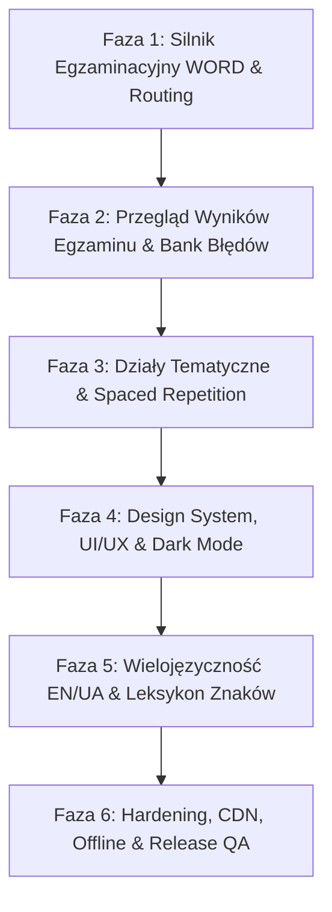

# Kompleksowy Plan Implementacji: EZprawko (Mobilna Aplikacja Przygotowująca do Egzaminu WORD)

> Zmiana zakresu (2026-10-13): gamifikacja została wycofana decyzją właściciela.
> Nie wdrażamy ponownie odznak, osiągnięć, wyzwań ani serii dni. Aktywne funkcje
> koncentrują się na nauce, egzaminie i historii/postępie; szczegóły w logu implementacji.

Dokument stanowi kompletny, techniczny plan rozwoju aplikacji mobilnej **EZprawko** (Expo SDK 57 / React Native / SQLite). Plan usuwa luki w zgodności z państwowym egzaminem teoretycznym WORD, podnosi standard UI/UX do poziomu czołowych aplikacji rynkowych i definiuje architekturę systemu w podziale na 6 niezależnych faz.

---

## 1. Architektura i Założenia Techniczne

* **Framework:** Expo SDK 57 (`~57.0.27`), React Native `0.86.3`, React `19.2.3`.
* **Nawigacja:** Expo Router 57 (file-based routing w `src/app/`, natywne taby, typed routes).
* **Baza Danych:** `expo-sqlite` (`prawo-jazdy.db`) – 3 518 oficjalnych pytań ministerialnych z załącznika rządowego, relacje pytań, odpowiedzi, flagi, historia sesji.
* **Multimedia:** `expo-video`, `expo-image`, serwis `media-cache.ts` oparty na `expo-file-system/legacy` (LRU cache, limit 1 GB, bounded preloading).
* **Audio & Haptyka:** `expo-audio` (wbudowane tony WAV w kodzie), `expo-haptics`.
* **Wymagania Jakościowe:** Każda zmiana musi przechodzić walidację:
  * `npx tsc --noEmit`
  * `npx expo lint`
  * `npx expo-doctor`

---

## 2. Prawne Warunki Egzaminu Państwowego WORD (Wymóg Rozporządzenia MI)

Aplikacja w trybie egzaminu musi bezwzględnie realizować reguły państwowe:
1. **Liczba i podział pytań:**
   * Łącznie **32 pytania** (Suma: **74 punkty**, próg zaliczenia: **min. 68 punktów**).
   * **Część podstawowa (pytania 1–20):** Odpowiedzi **TAK** lub **NIE**.
     * 10 pytań za 3 pkt (wysokie znaczenie dla BRD)
     * 6 pytań za 2 pkt (średnie znaczenie)
     * 4 pytania za 1 pkt (niskie znaczenie)
   * **Część specjalistyczna (pytania 21–32):** Odpowiedzi jednokrotnego wyboru **A, B, C**.
     * 6 pytań za 3 pkt
     * 4 pytania za 2 pkt
     * 2 pytania za 1 pkt
   * **Kolejność:** ZAWSZE najpierw 20 pytań podstawowych, a po nich 12 pytań specjalistycznych. Nigdy nie są przemieszane.
2. **Reżim czasowy (Dual Timer):**
   * **Zegar globalny:** 25 minut na całą sesję.
   * **Pytanie podstawowe:** 20 sekund na zapoznanie się z treścią (i obejrzenie filmu/zdjęcia) $\rightarrow$ 15 sekund na udzielenie odpowiedzi. W trakcie filmu odpowiedzi TAK/NIE są zablokowane.
   * **Pytanie specjalistyczne:** 50 sekund łącznie na przeczytanie i wybór A, B lub C.
   * **Auto-advance:** Po upływie czasu na dane pytanie system automatycznie przechodzi do kolejnego, zapisując brak odpowiedzi (0 pkt).
3. **Reguły odtwarzania wideo:**
   * Film odtwarza się **dokładnie jeden raz automatycznie**.
   * Brak jakichkolwiek kontrolek (pauza, przewijanie, ponowne odtworzenie są zablokowane).
4. **Brak możliwości powrotu:**
   * Po zatwierdzeniu odpowiedzi lub upływie czasu cofnięcie się do poprzednich pytań jest niemożliwe.
5. **Podsumowanie i wgląd w egzamin:**
   * Po zakończeniu natychmiastowy wynik: POZYTYWNY ($\ge 68$) lub NEGATYWNY ($< 68$).
   * Pełny wgląd w zestawienie wszystkich 32 pytań (co zaznaczono vs jaka jest poprawna odpowiedź).

---

## 3. Fazy Implementacji i Kamienie Milowe

---

### Faza 1: Silnik Egzaminacyjny WORD i Architektura Nawigacji (Priorytet Krytyczny)

**Cel:** Usunięcie niezgodności prawnych w losowaniu pytań, wdrożenie dwupoziomowego timera (20s/15s oraz 50s) i rozbicie monolitu `src/app/index.tsx`.

#### Zadania techniczne:
1. **Refaktoryzacja `src/domain/exam-engine.ts`:**
   * Zapewnienie, że w tablicy pytań egzaminu pozycje `0..19` stanowią pytania podstawowe (`PODSTAWOWY`), a `20..31` pytania specjalistyczne (`SPECJALISTYCZNY`).
   * Usunięcie losowego tasowania całości (`shuffle(selected)`). Tasowanie kandydatów odbywa się wyłącznie wewnątrz poszczególnych koszyków punktowych w danej części.
   * Dodanie metadanych czasu do pytania:
     * `readingTimeSeconds`: 20 dla podstawowego, 0 dla specjalistycznego.
     * `answeringTimeSeconds`: 15 dla podstawowego, 50 dla specjalistycznego.
2. **Wydzielenie ekranu egzaminu (`src/app/exam/[id].tsx`):**
   * Przeniesienie symulatora z `src/app/index.tsx` do dedykowanej trasy pełnoekranowej.
   * Oczyszczenie `src/app/index.tsx`: usunięcie martwego kodu `LegacyHomeScreen`, pozostawienie czystego Dashboardu.
   * Ukrycie dolnego paska zakładek podczas trwania egzaminu.
3. **Implementacja Maszyny Stanów Pytania (Question State Machine):**
   * Stan `MEDIA_PLAYING`: Film odtwarza się (brak możliwości kliknięcia TAK/NIE).
   * Stan `READING`: Odliczanie 20s (dla pytań bez filmu lub ze zdjęciem).
   * Stan `ANSWERING`: Odliczanie 15s (dla podstawowych) lub 50s (dla specjalistycznych).
   * Stan `TIMEOUT`: Automatyczne wywołanie `handleAnswer(null)` i przejście do kolejnego pytania.
4. **Tryb wideo bez kontrolek w egzaminie:**
   * Przekazanie flagi `examMode={true}` do `QuestionMedia`.
   * W trybie egzaminu: `nativeControls={false}`, brak zapętlania (`loop: false`), zdarzenie `onEnd` przełącza stan na `ANSWERING`.

#### Checkpoint 1 (Weryfikacja):
* [ ] Egzamin zawsze generuje dokładnie 20 pytań podstawowych na pozycjach 1–20 i 12 pytań specjalistycznych na pozycjach 21–32.
* [ ] Pytanie podstawowe odlicza 20s (czytanie/wideo), po czym aktywuje przyciski TAK/NIE na 15s.
* [ ] Po upływie 15s lub 50s następuje bezwzględne automatyczne przejście do kolejnego pytania.
* [ ] Pasek kart jest ukryty podczas egzaminu.
* [ ] `npx tsc --noEmit` i `npx expo lint` przechodzą bez błędów.

---

### Faza 2: Przegląd Wyników Egzaminu i Bank Błędów

**Cel:** Dostarczenie kursantowi pełnej informacji zwrotnej po zakończeniu symulacji oraz inteligentny system naprawy błędów.

#### Zadania techniczne:
1. **Nowy ekran podsumowania i przeglądu (`src/app/exam/review.tsx`):**
   * Przyjmuje `sessionId` jako parametr trasy.
   * Górna karta: Wynik punktowy (np. 69/74), werdykt (POZYTYWNY / NEGATYWNY), czas trwania.
   * Siatka 32 pytań (siatka 4×8 lub kafelki z numerami 1–32):
     * Kolor zielony: poprawna odpowiedź.
     * Kolor czerwony: błędna odpowiedź.
     * Kolor szary: brak odpowiedzi (timeout).
   * Po kliknięciu w kafelek: modal lub rozwinięcie z pełną treścią pytania, zdjęciem/filmem, zaznaczoną odpowiedzią, poprawną odpowiedzią oraz liczbą punktów.
2. **Kalkulator wpływu błędów:**
   * Raport diagnostyczny: *"Stracono 6 punktów w pytaniach o wysokim znaczeniu (3 pkt) z części podstawowej"*.
3. **Zapisywanie błędów do dedykowanego banku powtórek:**
   * Rozszerzenie tabeli `exam_answers` o pełny kontekst błędu.
   * Aktualizacja zapytania filtru `mistakes` w `src/app/study.tsx`, aby uwzględniało precyzyjną wagę i częstotliwość pomyłek.

#### Checkpoint 2 (Weryfikacja):
* [ ] Po ukończeniu egzaminu kursant może kliknąć "Przejrzyj swoje odpowiedzi" i zobaczyć siatkę 32 pytań.
* [ ] Każde pytanie w przeglądzie prezentuje dokładny wybór użytkownika vs klucz odpowiedzi.
* [ ] Błędne pytania natychmiast zasilają filtr "Błędy" w module nauki.
* [ ] `npx tsc --noEmit` i `npx expo lint` przechodzą bez błędów.

---

### Faza 3: Działy Tematyczne, Tryb Fiszek i Spaced Repetition

**Cel:** Zbudowanie modułu nauki dorównującego ZdamyTo i Ray, pozwalającego na naukę blokami materiału.

#### Zadania techniczne:
1. **Kategoryzacja tematyczna pytań w bazie danych:**
   * Dodanie kolumny `topic` do tabeli `questions` lub tabeli powiązań `question_topics`.
   * Główne bloki tematyczne WORD/OSK:
     1. *Znaki i sygnały drogowe*
     2. *Skrzyżowania i pierwszeństwo przejazdu*
     3. *Zasady ogólne i manewry (prędkość, wyprzedzanie, zmiana pasa)*
     4. *Wymiary, ładunek i ciągnięcie przyczepy*
     5. *Pierwsza pomoc i zachowanie w razie wypadku*
     6. *Warunki techniczne i obsługa pojazdu*
2. **Przebudowa ekranu nauki (`src/app/study.tsx`):**
   * Wybór trybu nauki: "Wg działów tematycznych", "Wszystkie pytania", "Trudne (3 pkt)", "Bank błędów", "Ulubione/Oznaczone".
   * Karta każdego działu prezentująca wskaźnik opanowania: np. *Skrzyżowania: 84/142 (59%)*.
3. **Widok fiszki pytania z gestem przesuwania:**
   * Przejście z listy pytań do pełnoekranowego widoku fiszki.
   * Możliwość swobodnego przechodzenia do następnego/poprzedniego pytania w trybie nauki (w nauce powrót jest dozwolony).
   * Odsłonięcie wyjaśnienia od razu po kliknięciu odpowiedzi.
4. **Algorytm Spaced Repetition (Utrwalanie wiedzy):**
   * Licznik udanych podejść z rzędu dla każdego pytania w `practice_attempts`.
   * Pytanie uznaje się za opanowane, gdy kursant odpowie na nie poprawnie 3 razy z rzędu w odstępach min. 24h.

#### Checkpoint 3 (Weryfikacja):
* [ ] Kursant może wejść w wybrany dział tematyczny i rozwiązywać pytania wyłącznie z tego zakresu.
* [ ] Widoczny jest globalny postęp: *Przerobiono X z 3518 pytań*.
* [ ] Fiszka pytania działa płynnie, pokazuje natychmiastowe wyjaśnienie i pozwala na przejście dalej/wstecz.
* [ ] `npx tsc --noEmit` i `npx expo lint` przechodzą bez błędów.

---

### Faza 4: Nowy Design System, UI/UX i Prawdziwy Dark Mode

**Cel:** Podniesienie estetyki do standardu aplikacji premium (nowoczesna typografia, spójny dark mode, likwidacja pozostałości szablonu Expo).

#### Zadania techniczne:
1. **Semantyczny Design System w `src/constants/theme.ts`:**
   * Zdefiniowanie pełnej palety tokenów dla `light` i `dark`:
     * `background`: `#F7F8F5` / `#111613`
     * `surface`: `#FFFFFF` / `#1A221D`
     * `surfaceElevated`: `#FFFFFF` / `#232D27`
     * `border`: `#DCE3DE` / `#2D3A31`
     * `primary`: `#1F704C` (akcent bezpiecznej zieleni)
     * `accentGold`: `#F0C96A`
     * `textPrimary`: `#18221D` / `#F0F4F1`
     * `textSecondary`: `#65756B` / `#9EB0A4`
     * `error`: `#E5484D`, `success`: `#30A46C`
2. **Refaktoryzacja stylów we wszystkich ekranach:**
   * Zastąpienie na sztywno wpisanych hex-kodów wartościami dynamicznymi z hooka `useTheme()`.
   * Obsługa automatycznego przełączania motywu lub manualnego wyboru w Ustawieniach.
3. **Przebudowa paska zakładek (`src/components/app-tabs.tsx`):**
   * Zastąpienie powielonej ikony `explore.png` unikalnymi ikonami natywnymi (Home, BookOpen, BarChart3, Settings).
   * Całkowite usunięcie `src/app/explore.tsx`.
   * Dodanie nowej zakładki: **Leksykon Znaków Drogowych** (`src/app/signs.tsx`).
4. **Ergonomia interfejsu (Thumb-friendly UX):**
   * Zwiększenie wysokości przycisków odpowiedzi do min. 58px z wyraźnymi literami A, B, C / TAK, NIE.
   * Animowane wskaźniki postępu i pulsujący timer poniżej 5 sekund (kolor żółty $\rightarrow$ czerwony).

#### Checkpoint 4 (Weryfikacja):
* [ ] Aplikacja wygląda perfekcyjnie w trybie ciemnym – zero nieczytelnych tekstów czy białych pól.
* [ ] Brak kodu szablonowego Expo.
* [ ] Wszystkie zakładki posiadają unikalne, czytelne ikony.
* [ ] Ekran główny prezentuje nowoczesny dashboard z pierścieniowym wykresem gotowości.
* [ ] `npx tsc --noEmit` i `npx expo lint` przechodzą bez błędów.

---

### Faza 5: Wielojęzyczność (EN / UA / DE) i Leksykon Znaków

**Cel:** Zdobycie przewagi rynkowej nad ZdamyTo i Prawo Jazdy 360 poprzez otwarcie aplikacji na obcokrajowców oraz zintegrowany leksykon znaków.

#### Zadania techniczne:
1. **Rozbudowa skryptu `scripts/import_question_bank.py`:**
   * Odczytanie kolumn wielojęzycznych z `gov-attachment.xlsx`:
     * `Pytanie [EN]`, `Odpowiedź A/B/C [EN]`
     * `Pytanie [UA]`, `Odpowiedź A/B/C [UA]`
     * `Pytanie [D]`, `Odpowiedź A/B/C [D]`
   * Zapisanie tłumaczeń do tabeli `question_translations (question_id, language, question, answers_json)`.
2. **Wybór języka w Ustawieniach (`src/app/settings.tsx`):**
   * Dodanie selektora języka egzaminu: Polski (domyślny), Angielski, Ukraiński, Niemiecki.
   * Pobieranie pytań z uwzględnieniem wybranego języka w repozytorium SQLite.
3. **Leksykon Znaków Drogowych (`src/app/signs.tsx`):**
   * Przeglądarka znaków z podziałem na grupy: A (ostrzegawcze), B (zakazu), C (nakazu), D (informacyjne), T (tabliczki).
   * Wyszukiwarka znaków po nazwie i kodzie (np. "B-20 Stop").
   * Powiązanie pytań egzaminacyjnych z konkretnymi znakami.

#### Checkpoint 5 (Weryfikacja):
* [ ] Zmiana języka na angielski lub ukraiński powoduje wyświetlanie oficjalnych ministerialnych tłumaczeń pytań.
* [ ] Moduł Leksykonu pozwala na szybkie przeglądanie znaków drogowych.
* [ ] `npx tsc --noEmit` i `npx expo lint` przechodzą bez błędów.

---

### Faza 6: Hardening, Multimedia CDN, Offline i Gotowość Produkcyjna

**Cel:** Finalne przygotowanie aplikacji do publikacji w Google Play i Apple App Store.

#### Zadania techniczne:
1. **Zabezpieczenie multimediów i prywatnego CDN:**
   * Wdrożenie skryptu sprawdzającego integralność plików MP4.
   * Obsługa graceful fallback w przypadku braku połączenia sieciowego i braku pliku w cache.
2. **Pełna walidacja trybu Offline:**
   * Test aplikacji w trybie samolotowym (Airplane Mode): pełny egzamin i nauka działami muszą działać bezbłędnie.
3. **Testy jednostkowe silnika egzaminacyjnego:**
   * Testy sprawdzające 1000 wygenerowanych egzaminów:
     * Dokładnie 32 pytania.
     * Zawsze 20 pytań podstawowych na pozycjach 0–19.
     * Zawsze 12 pytań specjalistycznych na pozycjach 20–31.
     * Suma punktów zawsze równa 74.
     * Brak duplikatów pytań w pojedynczej sesji.
4. **Konfiguracja EAS i audyt wydania:**
   * Konfiguracja `app.json` (wersjonowanie, splash screen, uprawnienia).
   * Sprawdzenie zgodności z `QA_CHECKLIST.md`.
   * Przejście `npx expo-doctor` (21/21 checks).

#### Checkpoint 6 (Weryfikacja):
* [ ] 100% testów jednostkowych silnika egzaminacyjnego przechodzi pomyślnie.
* [ ] `npx expo-doctor` zwraca 0 błędów i ostrzeżeń.
* [ ] `npx tsc --noEmit` oraz `npx expo lint` czyste.
* [ ] Aplikacja przetestowana na urządzeniu fizycznym w profilu preview.

---

## 4. Macierz Odpowiedzialności Plików

| Plik | Status | Kluczowe zadanie |
| :--- | :--- | :--- |
| `src/domain/exam-engine.ts` | **Modyfikacja** | Ścisły podział 20+12, usunięcie tasowania całości, metadane czasowe. |
| `src/app/index.tsx` | **Refaktoryzacja** | Usunięcie kodu egzaminu i szablonu, dedykowany Dashboard i Onboarding. |
| `src/app/exam/[id].tsx` | **Nowy plik** | Pełnoekranowy symulator egzaminu, Dual Timer (20s/15s i 50s), auto-advance. |
| `src/app/exam/review.tsx` | **Nowy plik** | Siatka 32 pytań, analiza błędów, podgląd sytuacji drogowej. |
| `src/app/study.tsx` | **Modyfikacja** | Działy tematyczne, gesty fiszek, natychmiastowe wyjaśnienia. |
| `src/app/signs.tsx` | **Nowy plik** | Zastępuje `explore.tsx`, interaktywny leksykon znaków drogowych. |
| `src/app/explore.tsx` | **Usunięcie** | Usunięcie niepotrzebnego pliku szablonu Expo. |
| `src/components/question-media.tsx` | **Modyfikacja** | Blokada kontrolek w trybie egzaminacyjnym (`nativeControls={false}`). |
| `src/components/app-tabs.tsx` | **Modyfikacja** | Nowe dedykowane ikony zakładek, podpięcie `signs.tsx`. |
| `src/constants/theme.ts` | **Modyfikacja** | Semantyczne tokeny Dark/Light mode dla całej aplikacji. |
| `src/database/repository.ts` | **Modyfikacja** | Obsługa działów tematycznych, języków i historii sesji egzaminów. |
| `scripts/import_question_bank.py` | **Modyfikacja** | Import kolumn wielojęzycznych (EN, UA, DE) z pliku Excel. |

---

## 5. Podsumowanie

Wdrożenie powyższego planu przekształca **EZprawko** z technicznego szkieletu w **najbardziej zaawansowaną i wierną przepisom aplikację na polskim rynku**. Projekt zyskuje unikalne przewagi konkurencyjne (wierność 1:1 z WORD, wsparcie dla obcokrajowców, nowoczesny natywny UX), zachowując przy tym lekkość i szybkość działania dzięki lokalnej bazie SQLite.
