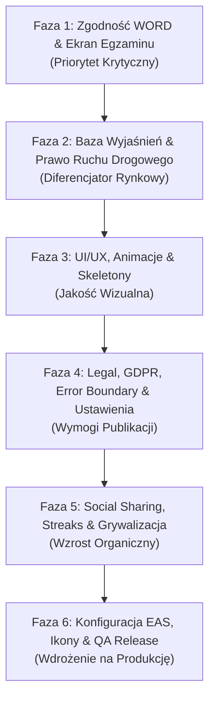

# Kompleksowy Plan Implementacji i Modernizacji: EZprawko

> **Aktualizacja zakresu 2026-10-13:** właściciel zdecydował o usunięciu gamifikacji
> dla prostszego UI i kodu. Odznaki, osiągnięcia, serie dni, wyzwania oraz celebracje
> wyników opisane niżej są wycofane, nie stanowią dalszych zadań. Nauka, egzaminy,
> historia i rzeczywiste statystyki postępu pozostają. Szczegóły w IMPLEMENTATION_PROGRESS.md.

> **Status projektu:** Baza z oficjalnymi pytaniami ministerialnymi i szkieletem architektury (Expo SDK 57, SQLite, offline-first) jest wdrożona. 
> Niniejszy dokument stanowi kompletny plan techniczny eliminacji luk prawnych i UX względem egzaminu państwowego WORD oraz wdrożenia kluczowych przewag konkurencyjnych na polskim rynku aplikacji prawa jazdy (względem ZdamyTo, Prawo Jazdy 360, Prawko.pl).

---

## 1. Audyt Stanu Obecnego i Przewagi Konkurencyjne

### Co działa wzorowo (Mocne strony)
1. **Silnik losowania pytań (`src/domain/exam-engine.ts`):** 
   - Wzorcowy podział 20 pytań podstawowych + 12 pytań specjalistycznych (nigdy nie są przemieszane).
   - Ścisła realizacja ministerialnych koszyków punktowych:
     - Podstawowe: 10×3 pkt, 6×2 pkt, 4×1 pkt (suma: 46 pkt).
     - Specjalistyczne: 6×3 pkt, 4×2 pkt, 2×1 pkt (suma: 28 pkt).
     - Łączna pula: dokładnie 74 punkty, próg zdawalności: $\ge 68$ pkt.
2. **Reżim czasowy i blokada nawigacji:** 
   - Globalny stoper 25 minut.
   - Pytania podstawowe: 20s zapoznanie/wideo + 15s na odpowiedź.
   - Pytania specjalistyczne: 50s łącznie na treść i wybór A/B/C.
   - Auto-advance po wyzerowaniu timera i całkowity brak możliwości powrotu do pytań (jak na terminalu WORD).
3. **Baza pytań i wielojęzyczność:** 
   - 3 518 oficjalnych pytań ministerialnych z załącznika rządowego.
   - Zintegrowane oficjalne tłumaczenia: Angielski (3 518), Niemiecki (3 517), Ukraiński (2 303) — unikalna cecha na polskim rynku.
4. **Leksykon Znaków Drogowych (`src/domain/road-signs.ts`):** 
   - 235 znaków z grafikami wektorowymi/WebP, podział na kategorie A/B/C/D/T oraz powiązania pytań ze znakami.
5. **Niezależność offline:** 
   - Całość bazy, logiki i metadanych działa lokalnie w oparciu o `expo-sqlite`.

---

## 2. Zidentyfikowane Luki (Compliance, UX i Rynkowe)

### 🔴 Luki Krytyczne (Wymagające natychmiastowej poprawy)
1. **Format przycisków części podstawowej w UI:**
   - W bazie danych (`questions.db`) odpowiedzi podstawowe to poprawnie `T` (Tak) oraz `N` (Nie).
   - W interfejsie (`src/app/exam/[id].tsx` i `src/app/study.tsx`) renderowane są identycznie jak część specjalistyczna: w postaci pionowej listy ze znaczkami `[T] Tak` i `[N] Nie`.
   - **Wymóg WORD:** Pytania podstawowe na dotykowych terminalach WORD posiadają dwa duże, wyraziste przyciski: **TAK** (akcent zielony) oraz **NIE** (akcent czerwony), bez oznaczeń literowych.
2. **Brak wyjaśnień do pytań:**
   - Tabela `question_explanations` istnieje w schemacie SQLite, ale jest pusta.
   - Na polskim rynku to funkcja nr 1 decydująca o zakupie i polecaniu aplikacji (sukces ZdamyTo opiera się na prostych wyjaśnieniach sytuacji drogowych).
3. **Brak ekranu odprawy przed egzaminem:**
   - Użytkownik po kliknięciu "Rozpocznij egzamin" od razu ląduje w odliczaniu pierwszego pytania.
   - Brakuje ekranu wprowadzającego prezentującego zasady (32 pytania, 25 min, próg 68 pkt, brak powrotu) zmniejszającego stres egzaminacyjny.

### 🟠 Luki Wizualne i Doświadczenia Użytkownika (UI/UX)
1. **Brak Skeleton Screens:** Wszystkie ekrany podczas odczytu SQLite wyświetlają surowy tekst *"Przygotowujemy..."*.
2. **Brak dynamiki timera:** Timer nie zmienia kolorów w krytycznych momentach (brak ostrzeżenia żółtego przy 10s i pulsującego czerwonego przy <5s).
3. **Płaskie przejścia:** Brak płynnych animacji przejścia między pytaniami (Slide/Fade) oraz animacji wyboru odpowiedzi.
4. **Ekran postępów:** Wykres słupkowy nie posiada linii progu zdawalności (68 pkt), brak dat ukończenia egzaminów oraz wskaźnika całościowego przerobienia bazy pytań.

### 🟡 Wymogi Prawne i Gotowości do Publikacji (Stores)
1. Brak ekranu Polityki Prywatności (RODO) i Regulaminu (wymóg Apple App Store i Google Play).
2. Brak mechanizmu obsługi awarii (Global Error Boundary).
3. Brak możliwości eksportu lub skasowania danych użytkownika.

---

## 3. Szczegółowy Harmonogram Wdrożenia (6 Faz)

---

### Faza 1: Zgodność z Egzaminem WORD i Kluczowe Poprawki UI
**Priorytet:** 🔴 Krytyczny  
**Czas realizacji:** ~3–4 dni

#### 1.1 Dedykowany interfejs TAK / NIE dla części podstawowej
- **Pliki:** `src/app/exam/[id].tsx`, `src/app/study.tsx`
- **Zakres zmian:**
  - Rozróżnienie renderowania na podstawie `question.scope === 'PODSTAWOWY'`:
    - Dla części podstawowej: dwa duże, wyraziste przyciski dotykowe (min. wysokość 70px):
      - **TAK** (kolor tła i obramowania z palety sukcesu / zieleni WORD).
      - **NIE** (kolor tła i obramowania z palety ostrzeżenia / czerwieni WORD).
      - Ukrycie prefiksów literowych `[T]` / `[N]` — wyświetlanie wyłącznie etykiety "TAK" / "NIE" (lub w wariancie językowym: "YES"/"NO", "JA"/"NEIN", "ТАК"/"НІ").
    - Dla części specjalistycznej: zachowanie 3 opcji wyboru (A, B, C) z literami identyfikującymi.
  - Wyraźna blokada przycisków w fazie czytania pytań podstawowych z wizualną kłódką / wygaszeniem.

#### 1.2 Ekran odprawy przed egzaminem (Briefing Screen)
- **Pliki:** `src/app/exam/start-modal.tsx` (nowy komponent) lub modal w `src/app/index.tsx`
- **Zakres zmian:**
  - Po kliknięciu "Rozpocznij egzamin" prezentacja ekranu informacyjnego imitującego procedurę WORD:
    - Informacja o wybranej kategorii (np. B).
    - Zestawienie: 32 pytania (20 podstawowych + 12 specjalistycznych).
    - Czas: 25 minut.
    - Próg: minimum 68 punktów na 74 możliwe.
    - Ostrzeżenie: *Brak możliwości powrotu do pytań po zatwierdzeniu odpowiedzi*.
    - Przycisk CTA: *Rozpocznij oficjalny egzamin*.

#### 1.3 Prezentacja pytań podstawowych w Przeglądzie Egzaminu
- **Pliki:** `src/app/exam/review.tsx`
- **Zakres zmian:**
  - W modalu/szczegółach pytania podstawowego prezentacja odpowiedzi jako kafelków TAK / NIE z wyraźnym oznaczeniem:
    - Odpowiedź wybrana przez użytkownika.
    - Poprawna odpowiedź wg klucza ministerialnego.

#### 1.4 Globalny Error Boundary
- **Pliki:** `src/components/error-boundary.tsx` (nowy), `src/app/_layout.tsx`
- **Zakres zmian:**
  - Przechwytywanie nieoczekiwanych błędów renderowania Reacta.
  - Ekran ratunkowy z możliwością bezpiecznego powrotu do ekranu głównego bez utraty bazy danych SQLite.

#### 📌 Checkpoint 1 (Kryteria odbioru):
- [ ] Pytania 1–20 w egzaminie i nauce posiadają dedykowane, duże przyciski TAK / NIE.
- [ ] Pytania 21–32 zachowują opcje A, B, C.
- [ ] Start egzaminu poprzedza ekran odprawy informujący o regułach WORD.
- [ ] W podsumowaniu egzaminu pytania podstawowe są poprawnie oznaczone jako TAK/NIE.
- [ ] `npx tsc --noEmit` oraz `npx expo lint` przechodzą bez błędów.

---

### Faza 2: Baza Wyjaśnień i Prawo o Ruchu Drogowym
**Priorytet:** 🟠 Wysoki (Kluczowy dla retencji i sprzedaży)  
**Czas realizacji:** ~1–2 tygodnie

#### 2.1 Architektura i integracja wyjaśnień
- **Pliki:** `src/database/repository.ts`, `src/database/explanations.ts` (nowy)
- **Zakres zmian:**
  - Utworzenie schematu i zasilenie tabeli `question_explanations`:
    - Kolumny: `question_id`, `explanation_text`, `legal_basis` (np. *Art. 25 ust. 1 Ustawy Prawo o Ruchu Drogowym*), `source_url`.
  - Wdrożenie zasilenia dla pierwszego priorytetowego pakietu:
    - Wszystkie pytania o wadze 3 punktów (najbardziej rzutujące na wynik egzaminu).
    - Pytania ze skrzyżowaniami i pierwszeństwem przejazdu.

#### 2.2 Prezentacja wyjaśnień w Nauce i Przeglądzie
- **Pliki:** `src/app/study.tsx`, `src/app/exam/review.tsx`
- **Zakres zmian:**
  - W module nauki: po udzieleniu odpowiedzi natychmiastowe rozwinięcie sekcji:
    - *"Dlaczego ta odpowiedź jest poprawna?"*
    - Zwięzłe wyjaśnienie sytuacji w prostym języku.
    - Podstawa prawna z bezpośrednim odniesieniem do kodeksu drogowego.
  - W przeglądzie egzaminu: możliwość sprawdzenia wyjaśnienia dla każdego błędnie rozwiązanego pytania.

#### 2.3 Filtr "Najtrudniejsze pytania"
- **Pliki:** `src/app/study.tsx`, `src/database/repository.ts`
- **Zakres zmian:**
  - Dodanie dedykowanego filtra obok "Wszystkie", "3 pkt", "Podstawowe", "Błędy":
    - Filtr **Najtrudniejsze** — agregujący pytania za 3 pkt oraz pytania, w których użytkownik najczęściej popełnia błędy w sesjach ćwiczeniowych.

#### 📌 Checkpoint 2 (Kryteria odbioru):
- [ ] Wyjaśnienia pojawiają się w trybie nauki po kliknięciu odpowiedzi.
- [ ] Podstawa prawna (artykuł PoRD) jest wyświetlana pod wyjaśnieniem.
- [ ] Przegląd egzaminu pozwala sprawdzić wyjaśnienie do pomyłek.
- [ ] `npx tsc --noEmit` oraz `npx expo lint` przechodzą bez błędów.

---

### Faza 3: UI/UX, Mikroanimacje i Skeleton Loading
**Priorytet:** 🟡 Średni-Wysoki  
**Czas realizacji:** ~4–5 dni

#### 3.1 Zastąpienie surowego tekstu komponentami Skeleton
- **Pliki:** `src/components/skeleton.tsx` (nowy), `src/app/index.tsx`, `src/app/study.tsx`, `src/app/progress.tsx`
- **Zakres zmian:**
  - Zbudowanie uniwersalnego komponentu skeleton z efektem shimmer (pulsowanie opaciti/gradientu).
  - Wyeliminowanie tekstów *"Przygotowujemy..."* na rzecz szkieletów kart statystyk, listy działów i pytań.

#### 3.2 Dynamiczny i alarmujący Timer Egzaminacyjny
- **Pliki:** `src/components/exam-timer.tsx`, `src/app/exam/[id].tsx`
- **Zakres zmian:**
  - Kolorystyka paska/odznaki timera:
    - Czas standardowy ($> 10\text{ s}$): stonowany akcent motywu.
    - Czas ostrzegawczy ($5\text{ s} - 10\text{ s}$): kolor żółty/pomarańczowy ostrzegawczy.
    - Czas krytyczny ($< 5\text{ s}$): pulsujący kolor czerwony z subtelną wibracją haptyczną (`Haptics.notificationAsync`).
  - Poszanowanie ustawień systemowych dostępności ("Ograniczaj ruch").

#### 3.3 Animacje przejścia pytań i celebracja sukcesu
- **Pliki:** `src/app/exam/[id].tsx`, `src/app/exam/review.tsx`
- **Zakres zmian:**
  - Płynne przejście typu slide przy zmianie pytania (React Native Animated / LayoutAnimation).
  - Ekran wyniku:
    - Płynne narastanie licznika punktów (od 0 do wyniku końcowego np. 71/74).
    - Animacja sukcesu (konfetti / zielony rozbłysk) dla egzaminu zdanego ($\ge 68$ pkt).

#### 3.4 Usprawnienie Ekranu Postępów (`src/app/progress.tsx`)
- **Pliki:** `src/app/progress.tsx`
- **Zakres zmian:**
  - Dodanie poziomej linii referencyjnej dla 68 punktów na wykresie ostatnich podejść.
  - Etykiety z datami i godzinami pod słupkami sesji.
  - Karta zbiorcza: łączna liczba rozwiązanych unikalnych pytań (np. *Przerobiono 1 450 z 3 518 pytań – 41% bazy*).

#### 📌 Checkpoint 3 (Kryteria odbioru):
- [ ] Brak surowego tekstu "Przygotowujemy...", zastąpiony eleganckimi skeletonami.
- [ ] Timer poniżej 5 sekund wyraźnie ostrzega kolorem czerwonym i pulsowaniem.
- [ ] Wykres postępów posiada linię zaliczenia 68 pkt oraz daty.
- [ ] `npx tsc --noEmit` oraz `npx expo lint` przechodzą bez błędów.

---

### Faza 4: Bezpieczeństwo, Prawo (GDPR/RODO) i Ustawienia
**Priorytet:** 🟡 Średni (Wymóg Google Play & Apple App Store)  
**Czas realizacji:** ~3 dni

#### 4.1 Ekran "O Aplikacji" i Informacje Prawne
- **Pliki:** `src/app/settings.tsx`, `src/app/legal/privacy.tsx` (nowy), `src/app/legal/terms.tsx` (nowy)
- **Zakres zmian:**
  - Dodanie pełnego tekstu Polityki Prywatności w języku polskim (zgodność z RODO: przetwarzanie lokalne, opcjonalny Supabase, brak sprzedaży danych).
  - Regulamin świadczenia usług.
  - Wyświetlanie numeru wersji aplikacji, numeru buildu i licencji danych ministerialnych (Ministerstwo Infrastruktury RP).

#### 4.2 Zarządzanie Danymi i RODO (Data Privacy)
- **Pliki:** `src/app/settings.tsx`, `src/database/repository.ts`
- **Zakres zmian:**
  - Przycisk **Resetuj postępy** z oknem potwierdzenia (Alert dialog).
  - Przycisk **Eksportuj moje dane** (zrzut sesji i postępów do pliku JSON).
  - Przycisk **Usuń wszystkie dane** (pełne czyszczenie lokalnej bazy SQLite).

#### 4.3 Konfigurowalny Czas Przypomnień
- **Pliki:** `src/app/settings.tsx`, `src/services/notifications.ts`
- **Zakres zmian:**
  - Zastąpienie sztywnej godziny 19:00 selektorem wyboru preferowanej godziny nauki.

#### 📌 Checkpoint 4 (Kryteria odbioru):
- [ ] Podstrony Polityka Prywatności i Regulamin są dostępne w Ustawieniach.
- [ ] Opcje resetu i eksportu danych działają zgodnie z RODO.
- [ ] Godzina powiadomienia jest konfigurowalna przez użytkownika.
- [ ] `npx tsc --noEmit` oraz `npx expo lint` przechodzą bez błędów.

---

### Faza 5: Retencja, Grywalizacja i Social Sharing
**Priorytet:** 🔵 Średni  
**Czas realizacji:** ~4–5 dni

#### 5.1 Generowanie karty wyniku i udostępnianie (Share Card)
- **Pliki:** `src/components/exam-share-card.tsx` (nowy), `src/app/exam/review.tsx`
- **Zakres zmian:**
  - Dedykowana, estetyczna karta graficzna generowana po zdanym egzaminie:
    - Nagłówek: *"ZDAŁEM TEORIĘ! 🏆"*
    - Wynik: np. *72 / 74 pkt*
    - Logo i podpis: *Przygotowano z EZprawko*
  - Wykorzystanie natywnego mechanizmu udostępniania (`Share.share` w React Native) do Instagram Stories, Facebooka, WhatsAppa czy zapisu w galerii.

#### 5.2 System Dni Nauki (Streaks) i Osiągnięcia
- **Pliki:** `src/app/index.tsx`, `src/database/repository.ts`
- **Zakres zmian:**
  - Rozbudowa tabeli `challenge_days` w pełny mechanizm Daily Streak:
    - Licznik dni z rzędu z płomieniem na Dashboardzie.
    - Odznaki motywacyjne:
      - 🎯 *Pierwszy krok* (ukończenie pierwszego egzaminu).
      - 🔥 *W ogniu nauki* (3 dni z rzędu).
      - 💯 *Mistrz przepisów* (wynik 74/74 pkt).
      - 🛑 *Ekspert znaków* (opanowanie pytań ze znakami drogowymi).

#### 5.3 Podsumowanie sesji w trybie Nauki
- **Pliki:** `src/app/study.tsx`
- **Zakres zmian:**
  - Po przerobieniu wybranej partii pytań (np. 10 lub całego działu) wyświetlenie ekranu podsumowania:
    - Liczba poprawnych vs błędnych odpowiedzi.
    - Zmiana wskaźnika opanowania materiału.
    - Przyciski: *"Powtórz błędy"* oraz *"Wróć do menu"*.

#### 📌 Checkpoint 5 (Kryteria odbioru):
- [ ] Użytkownik może udostępnić wynik zdanego egzaminu za pomocą natywnego menu udostępniania.
- [ ] Licznik dni z rzędu (streak) nalicza się prawidłowo na Dashboardzie.
- [ ] Sesje nauki kończą się kartą podsumowującą z opcją powtórki błędów.
- [ ] `npx tsc --noEmit` oraz `npx expo lint` przechodzą bez błędów.

---

### Faza 6: Konfiguracja Produkcyjna, EAS i Publikacja
**Priorytet:** 🟢 Finalny  
**Czas realizacji:** ~3–4 dni

#### 6.1 Branding i Grafika Aplikacji
- **Pliki:** `app.json`, katalog `assets/images/`
- **Zakres zmian:**
  - Przygotowanie oficjalnej ikony aplikacji (`icon.png` 1024×1024 px).
  - Ikona adaptacyjna dla Androida (`adaptive-icon.png`).
  - Ekran powitalny (`splash-icon.png`) dopasowany do motywów Light i Dark.

#### 6.2 Konfiguracja EAS Build i Code Signing
- **Pliki:** `eas.json`, `app.json`
- **Zakres zmian:**
  - Profile buildów w `eas.json`: `development`, `preview`, `production`.
  - Konfiguracja paczek Android (`applicationId: pl.ezprawko.app`) oraz iOS (`bundleIdentifier: pl.ezprawko.app`).
  - Integracja OTA updates (`eas update`).

#### 6.3 Testy Końcowe i Diagnostyka
- **Zakres działań:**
  - Wykonanie procedury z `QA_CHECKLIST.md` na urządzeniach fizycznych (Android & iOS).
  - Test stabilności w trybie samolotowym (Airplane Mode).
  - Uruchomienie audytu zależności: `npx expo-doctor`.

#### 📌 Checkpoint 6 (Kryteria odbioru):
- [ ] Ikona i splash screen prezentują się profesjonalnie na iOS i Androidzie.
- [ ] `eas build --profile preview` buduje się poprawnie bez błędów natywnych.
- [ ] `npx expo-doctor` zwraca stan czysty (wszystkie reguły spełnione).
- [ ] Aplikacja jest gotowa do zgłoszenia w Google Play Console i App Store Connect.

---

## 4. Macierz Kluczowych Plików Projektu

| Ścieżka pliku | Rola w systemie | Planowane zmiany |
| :--- | :--- | :--- |
| `src/app/exam/[id].tsx` | Ekran egzaminu państwowego | Przyciski TAK/NIE dla bazy podstawowej, timer pulsacyjny, slide animacje |
| `src/app/study.tsx` | Ekran nauki pytań | Obsługa TAK/NIE, sekcja wyjaśnień sytuacji, filtr najtrudniejszych pytań |
| `src/app/exam/review.tsx` | Podsumowanie egzaminu | Kafelki TAK/NIE, wyjaśnienia błędów, funkcja udostępniania wyniku (Share Card) |
| `src/app/index.tsx` | Dashboard główny | Onboarding modal przed egzaminem, skeletony, wskaźnik streak (płomień) |
| `src/app/progress.tsx` | Ekran analityki postępów | Linia progu 68 pkt, znaczniki dat, statystyki globalne przerobienia bazy |
| `src/app/settings.tsx` | Ustawienia aplikacji | Polityka prywatności, regulamin, eksport RODO, konfigurator godziny powiadomień |
| `src/components/exam-timer.tsx` | Komponent odliczania czasu | Zmiana barw (zielony $\rightarrow$ żółty $\rightarrow$ pulsujący czerwony) przy $<5\text{ s}$ |
| `src/components/skeleton.tsx` | Nowy komponent szkieletowy | Płynne stany ładowania (shimmer) zastępujące teksty "Przygotowujemy..." |
| `src/components/error-boundary.tsx` | Nowy komponent bezpieczeństwa | Przechwytywanie błędów renderowania w drzewie komponentów |
| `src/database/repository.ts` | Warstwa danych SQLite | Pobieranie wyjaśnień, filtrowanie trudnych pytań, obsługa resetu i eksportu RODO |

---

## 5. Podsumowanie Korzyści Rynkowych

Wdrożenie powyższego 6-fazowego planu da aplikacji **EZprawko**:
1. **Pełną zgodność z procedurą WORD:** Prawdziwe przyciski TAK/NIE oraz odprawa przed egzaminem eliminują zarzuty o niedokładność symulacji.
2. **Standard rynkowy wyjaśnień:** Dostarczenie odpowiedzi na pytanie *"Dlaczego tak?"* z odniesieniem do Kodeksu Drogowego odbiera jedyny poważny atut ZdamyTo.
3. **Nowoczesność wizualną:** Aplikacja zyskuje przewagę nad przestarzałymi interfejsami konkurencji dzięki skeletonom, ciemnemu motywowi, animacjom i natywnym ikonom.
4. **Viralowy wzrost:** Gotowe karty udostępniania wyników ze zdanego egzaminu napędzają bezpłatną akwizycję nowych kursantów w social media.
